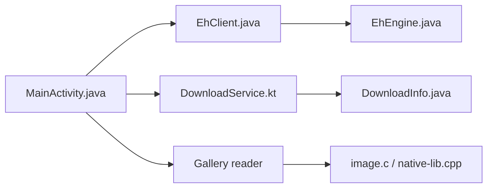

# xiaojieonly/Ehviewer_CN_SXJ

> Navigateur Android pour la galerie E-Hentai, avec téléchargements hors ligne, en chinois.

## Le problème
Parcourir et lire des galeries E-Hentai sur mobile avec téléchargement pour lecture hors ligne.

## Ce que ça fait vraiment
Application Android : navigation et recherche de galeries, détail, lecteur d'images, gestionnaire de téléchargements (service dédié), téléchargements d'archives et de torrents, import d'albums locaux et migration de téléchargements par Wi-Fi. Décodage d'images et de GIF en code natif. Le journal de versions du README est détaillé. Le contenu du site cible est pour adultes.

## Comment c'est branché


## Essayer
```bash
git clone https://github.com/xiaojieonly/Ehviewer_CN_SXJ.git
cd EhViewer
./gradlew app:assembleDebug
```

## Coût et pièges
Gratuit. Les APK sont proposés via pans de stockage tiers (Baidu, Quark, Lanzou) et torrent. Le code mentionne Firebase Crashlytics et un envoi de champs d'analytique : télémétrie probable. Des droits de gestion de fichiers sont requis.

## Ce que ce n'est pas
Pas un client officiel : le README prévient que les sites se disant « officiels » sont faux. Le diagramme n'expose pas tous les appels UI-service.

## Alternatives
Aucune alternative nommée dans le README (il remercie Hippo/seven332, fondateur d'EhViewer).

## Pour toi
À ignorer : application grand public sans lien avec ton métier, et son modèle de distribution invite à la prudence.

