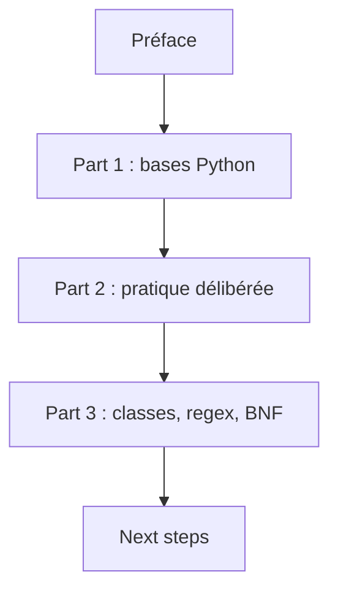

# xiaolai/the-craft-of-selfteaching

> Chinese book in Jupyter notebooks about self-learning, with Python as the entry point.

## The problem
Learning to program on your own without a methodical framework or deliberate practice.

## What it actually does
A book by Li Xiaolai in Jupyter chapters (and a Markdown version): why self-learning, Python basics (values, flow, functions, strings, containers, files), deliberate practice, classes, regex, BNF, then appendices (VS Code, Git, JupyterLab). The diagram only reflects the order of the chapters.

## How it is wired


## Trying it
```bash
# non documenté : lecture des notebooks via JupyterLab (voir T-appendix.jupyter-installation-and-setup)
```

## Cost and gotchas
Free; in Chinese. The text cites CC-BY-NC-ND, while GitHub detects no license.

## What it is not
Not a data science course: a general-purpose learning book.

## Alternatives
No alternative named.

## For you
Ignore: beginner content in Chinese, NC-ND license, of little use to an experienced data/AI profile.
