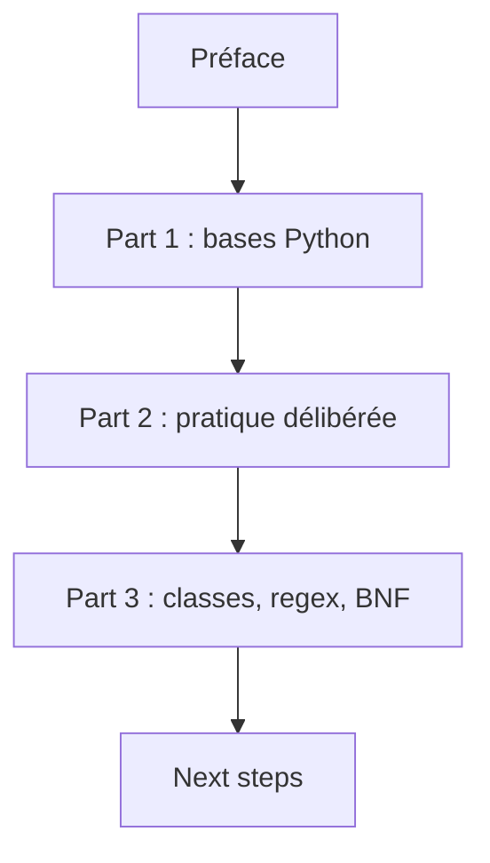

# xiaolai/the-craft-of-selfteaching

> Livre chinois en notebooks Jupyter sur l'auto-apprentissage, avec Python comme porte d'entrée.

## Le problème
Apprendre seul à programmer sans cadre méthodique ni pratique délibérée.

## Ce que ça fait vraiment
Un livre de Li Xiaolai en chapitres Jupyter (et version Markdown) : pourquoi l'auto-apprentissage, bases de Python (valeurs, flux, fonctions, chaînes, conteneurs, fichiers), pratique délibérée, classes, regex, BNF, puis annexes (VS Code, Git, JupyterLab). Le diagramme ne reflète que l'ordre des chapitres.

## Comment c'est branché


## Essayer
```bash
# non documenté : lecture des notebooks via JupyterLab (voir T-appendix.jupyter-installation-and-setup)
```

## Coût et pièges
Gratuit ; en chinois. Le texte cite CC-BY-NC-ND, alors que GitHub ne détecte aucune licence.

## Ce que ce n'est pas
Pas un cours de data science : un livre d'apprentissage généraliste.

## Alternatives
Aucune alternative nommée.

## Pour toi
Ignorer : contenu débutant en chinois, licence NC-ND, peu utile à un profil data/IA confirmé.

