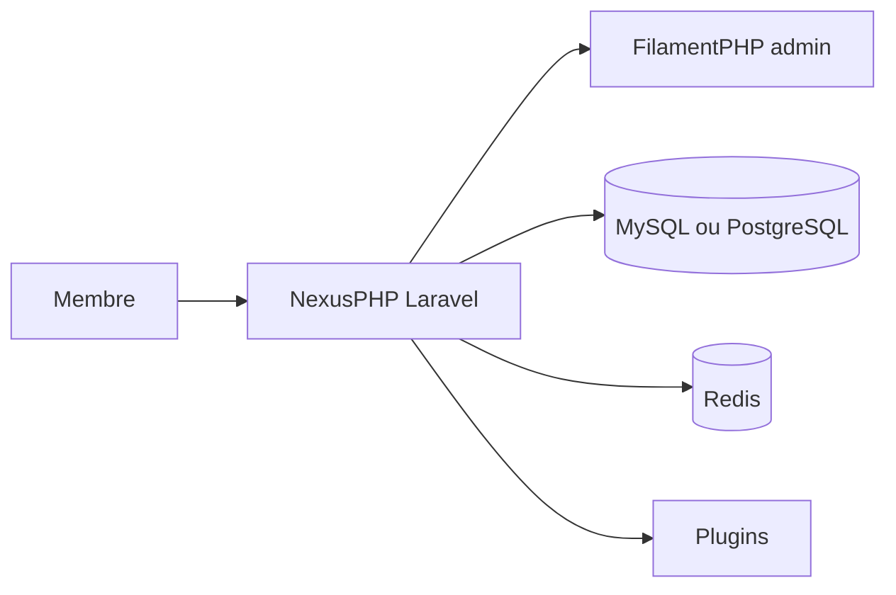

# xiaomlove/nexusphp

> Complete solution for setting up a PT site (private BitTorrent tracker), on Laravel and FilamentPHP.

## The problem
Setting up a PT site requires assembling a forum, a tracker system, moderation and administration by hand.

## What it actually does
The README (in Chinese) lists the features: torrent upload, special section, requests, subtitles, member rating, H&R, badges, forum, automatic backup, JSON API and administration. Plugins add a lucky wheel, menus, a Telegram bot. It relies on PHP 8.2 to 8.5, MySQL 5.7 or PostgreSQL 16, Redis, supervisor and rsync.

## How it is wired
Simplified diagram based on the sheet, no diagram provided.


## Trying it
```bash
docker pull xiaomlove/nexusphp:latest
docker run --name my-nexusphp -e DOMAIN=xxx.com -p 80:80 xiaomlove/nexusphp:latest
```

## Cost and gotchas
You need a domain (or an IP), a server and many PHP extensions. The README recommends a real-machine installation for production, and contains an advertisement for a hosting provider.

## What it is not
It is not a data or AI tool. Documentation mainly in Chinese. Compliance of the shared content remains your responsibility.

## Alternatives
No alternative named in the README.

## For you
Ignore: it is an engine for a torrent-sharing site, unrelated to your data / AI / MLOps profile.
