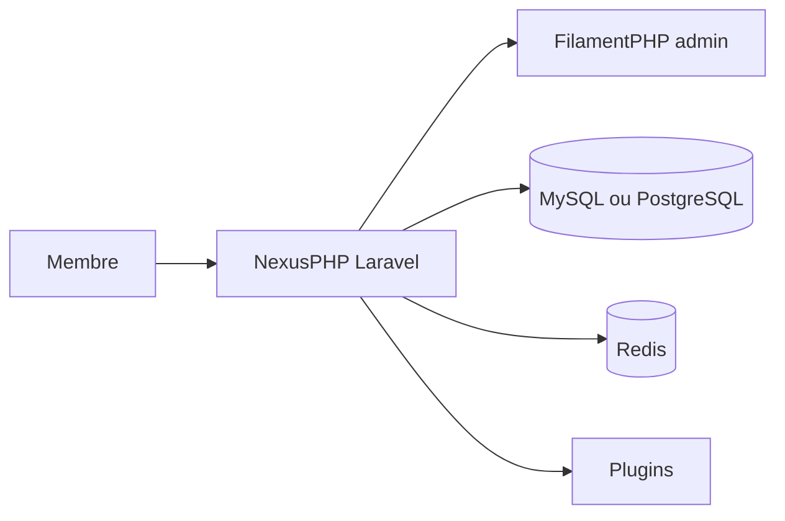

# xiaomlove/nexusphp

> Solution complète pour monter un site PT (tracker BitTorrent privé), sur Laravel et FilamentPHP.

## Le problème
Monter un site PT demande de réunir à la main forum, système de tracker, modération et administration.

## Ce que ça fait vraiment
Le README (en chinois) liste les fonctions : dépôt de torrents, zone spéciale, demandes, sous-titres, évaluation des membres, H&R, badges, forum, sauvegarde automatique, API JSON et administration. Des plugins ajoutent la roue de la chance, des menus, un bot Telegram. Il s'appuie sur PHP 8.2 à 8.5, MySQL 5.7 ou PostgreSQL 16, Redis, supervisor et rsync.

## Comment c'est branché
Schéma simplifié d'après la fiche, sans diagramme fourni.


## Essayer
```bash
docker pull xiaomlove/nexusphp:latest
docker run --name my-nexusphp -e DOMAIN=xxx.com -p 80:80 xiaomlove/nexusphp:latest
```

## Coût et pièges
Il faut un domaine (ou une IP), un serveur et de nombreuses extensions PHP. Le README recommande une installation sur machine réelle pour la production, et contient une publicité pour un hébergeur.

## Ce que ce n'est pas
Ce n'est pas un outil de data ou d'IA. Documentation principalement en chinois. La conformité du contenu partagé reste ton affaire.

## Alternatives
Aucune alternative nommée dans le README.

## Pour toi
À ignorer : c'est un moteur de site de partage de torrents, sans lien avec ton profil data / IA / MLOps.

