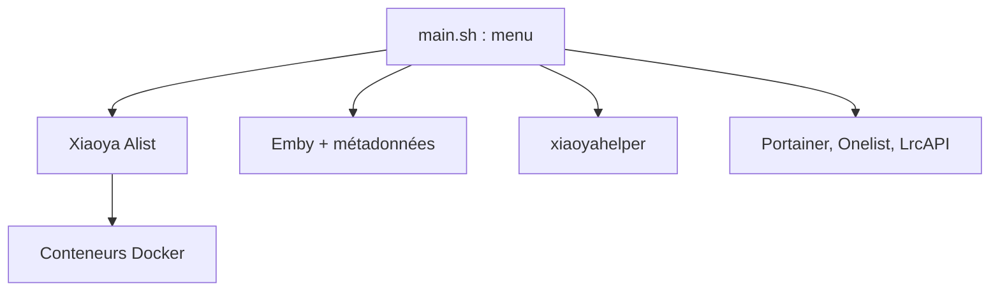

# xiaoyaDev/xiaoya-alist

> All-in-one installation script for an Alist and Emby media server, with metadata, documentation in Chinese.

## The problem
Setting up the "Xiaoya" stack (Alist, Emby, metadata, proxies, cleanup tools) by hand is slow: the script installs everything through menus.

## What it actually does
A `main.sh` script with a numbered menu installs, updates and uninstalls Docker containers: Alist, Emby with its metadata, a crawler bot, helpers (115 cleanup, Portainer, Onelist, LrcAPI, CasaOS). The README gives an architecture and system compatibility table. The Jellyfin menu is deprecated.

## How it is wired
Simplified diagram based on the sheet, no diagram provided.



## Trying it
```bash
bash -c "$(curl --insecure -fsSL https://ddsrem.com/xiaoya_install.sh)"
```

## Cost and gotchas
Free. Docker is mandatory. The script runs with `curl --insecure`: certificate verification is disabled, which exposes you to substitution. Added clauses: no commercial use, no illegal use, data loss at your own risk.

## What it is not
It is not standalone software: it orchestrates third-party images. It is used to access shared content; the README places legal responsibility on the user.

## Alternatives
One line: monlor/docker-xiaoya for a Docker Compose deployment, cited in the README.

## For you
Ignore: a media server outside your domain, installed by a remote script with no certificate verification.
