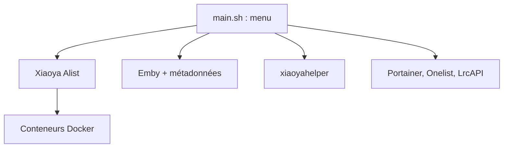

# xiaoyaDev/xiaoya-alist

> Script d'installation tout-en-un d'un serveur de médias Alist et Emby, avec métadonnées, documentation en chinois.

## Le problème
Monter la pile « Xiaoya » (Alist, Emby, métadonnées, proxys, outils de nettoyage) à la main est long : le script installe tout par menus.

## Ce que ça fait vraiment
Un script `main.sh` à menu numéroté installe, met à jour et désinstalle des conteneurs Docker : Alist, Emby avec ses métadonnées, un robot d'exploration, des assistants (nettoyage 115, Portainer, Onelist, LrcAPI, CasaOS). Le README donne un tableau de compatibilité d'architectures et de systèmes. Le menu Jellyfin est déprécié.

## Comment c'est branché
Schéma simplifié d'après la fiche, sans diagramme fourni.



## Essayer
```bash
bash -c "$(curl --insecure -fsSL https://ddsrem.com/xiaoya_install.sh)"
```

## Coût et pièges
Gratuit. Docker obligatoire. Le script s'exécute avec `curl --insecure` : la vérification du certificat est coupée, ce qui expose à une substitution. Clauses ajoutées : pas d'usage commercial, pas d'usage illégal, pertes de données à tes risques.

## Ce que ce n'est pas
Ce n'est pas un logiciel autonome : il orchestre des images tierces. Il sert à accéder à des contenus partagés ; le README renvoie la responsabilité légale à l'utilisateur.

## Alternatives
Une ligne : monlor/docker-xiaoya pour un déploiement Docker Compose, citée dans le README.

## Pour toi
À ignorer : un serveur de médias hors de ton domaine, installé par un script distant sans vérification de certificat.

