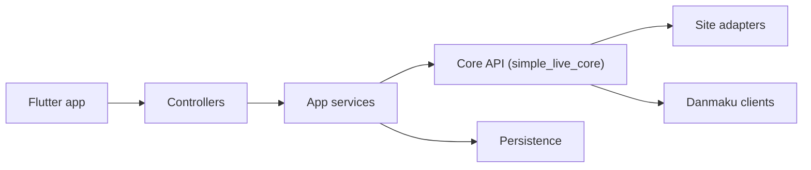

# xiaoyaocz/dart_simple_live

> Flutter app for watching Chinese live streams (Huya, Douyu, Bilibili, Douyin), to be built yourself.

## The problem
Watching Chinese live-streaming platforms with a simple client and scrolling comments (danmaku).

## What it actually does
Dart monorepo: `simple_live_core` (site adapters, network, danmaku, Tars/protobuf protocols), `simple_live_app` (Flutter), `simple_live_tv_app` (Android TV) and `simple_live_console`. Follows, history, synchronization (WebDAV, SignalR), local database. README in Chinese.

## How it is wired

## Trying it
No command in the README. Flutter 3.38 required; no installation package provided, it must be built.

## Cost and gotchas
Free. Depends on third-party platforms and their unofficial APIs. Commercial use is forbidden according to the statement, while the license is GPL-3.0.

## What it is not
No prebuilt version: the README asks you to build it. Desktop platforms are in beta.

## Alternatives
The README cites AllLive, the C# version by the same author.

## For you
Ignore: consumer application unrelated to your field, built on unofficial APIs.
