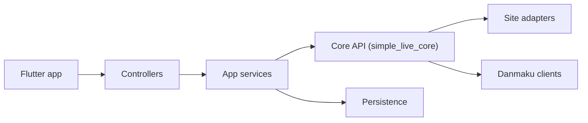

# xiaoyaocz/dart_simple_live

> Application Flutter pour regarder des directs chinois (Huya, Douyu, Bilibili, Douyin), à compiler soi-même.

## Le problème
Regarder des plateformes de direct chinoises avec un client simple et des commentaires défilants (danmaku).

## Ce que ça fait vraiment
Monorepo Dart : `simple_live_core` (adaptateurs de sites, réseau, danmaku, protocoles Tars/protobuf), `simple_live_app` (Flutter), `simple_live_tv_app` (Android TV) et `simple_live_console`. Suivis, historique, synchronisation (WebDAV, SignalR), base locale. README en chinois.

## Comment c'est branché

## Essayer
Aucune commande dans le README. Flutter 3.38 requis ; pas de paquet d'installation fourni, à compiler.

## Coût et pièges
Gratuit. Dépend de plateformes tierces et de leurs API non officielles. Usage commercial interdit selon la déclaration, alors que la licence est GPL-3.0.

## Ce que ce n'est pas
Pas de version précompilée : le README demande de compiler. Plateformes de bureau en bêta.

## Alternatives
Le README cite AllLive, la version C# du même auteur.

## Pour toi
À ignorer : application grand public sans rapport avec ton métier, fondée sur des API non officielles.

