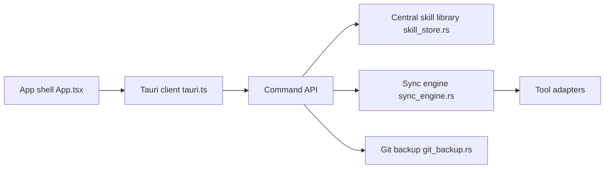

# xingkongliang/skills-manager

> Desktop app and CLI that centralize your agent skills and deploy them to each tool.

## The problem
Skills are scattered across each agent's folders: duplicates, manual updates, no backup.

## What it actually does
Central library (`~/.skills-manager`) fed by Git, archives, folders or the skills.sh marketplace. Presets, global and per-project spaces, synchronization by symlink or copy, update tracking, multi-device Git backup with per-skill merging. Agents can drive the tool via the `manage-skills` skill. Tauri 2, Rust, SQLite.

## How it is wired


## Trying it
```bash
brew install --cask skills-manager
npm run cli -- skills list
npm run cli -- skills install ./my-skill
npm run cli -- skills deploy react-best-practices --agent claude_code --agent codex
npx skills add xingkongliang/skills-manager
```

## Cost and gotchas
Free. The backup uses a private GitHub repo via OAuth login. On Windows, symlinks to WSL are impossible: copy only. 245 open issues.

## What it is not
Not a skill generator: a file and deployment manager. Secrets and keys are not backed up.

## Alternatives
`npx skills` (cited as a selective installation tool).

## For you
Worth watching: useful if you use several agents and dozens of skills, with Git backup; otherwise, symlinks are enough.
