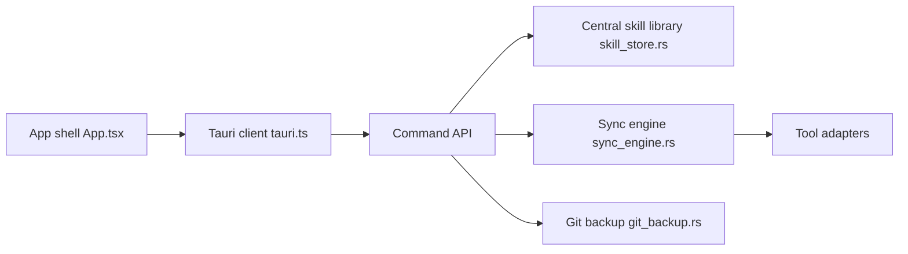

# xingkongliang/skills-manager

> Application de bureau et CLI qui centralisent tes skills d'agents et les déploient vers chaque outil.

## Le problème
Les skills sont éparpillés dans les dossiers de chaque agent : doublons, mises à jour manuelles, aucune sauvegarde.

## Ce que ça fait vraiment
Bibliothèque centrale (`~/.skills-manager`) alimentée par Git, archives, dossiers ou marketplace skills.sh. Presets, espaces globaux et par projet, synchronisation par lien symbolique ou copie, suivi des mises à jour, sauvegarde Git multi-appareils avec fusion par skill. Les agents peuvent piloter l'outil via le skill `manage-skills`. Tauri 2, Rust, SQLite.

## Comment c'est branché


## Essayer
```bash
brew install --cask skills-manager
npm run cli -- skills list
npm run cli -- skills install ./my-skill
npm run cli -- skills deploy react-best-practices --agent claude_code --agent codex
npx skills add xingkongliang/skills-manager
```

## Coût et pièges
Gratuit. La sauvegarde utilise un dépôt GitHub privé via connexion OAuth. Sous Windows, les liens symboliques vers WSL sont impossibles : copie seulement. 245 issues ouvertes.

## Ce que ce n'est pas
Pas un générateur de skills : un gestionnaire de fichiers et de déploiement. Les secrets et clés ne sont pas sauvegardés.

## Alternatives
`npx skills` (cité comme outil d'installation sélective).

## Pour toi
À surveiller : utile si tu cumules plusieurs agents et dizaines de skills, avec sauvegarde Git ; sinon, des liens symboliques suffisent.

