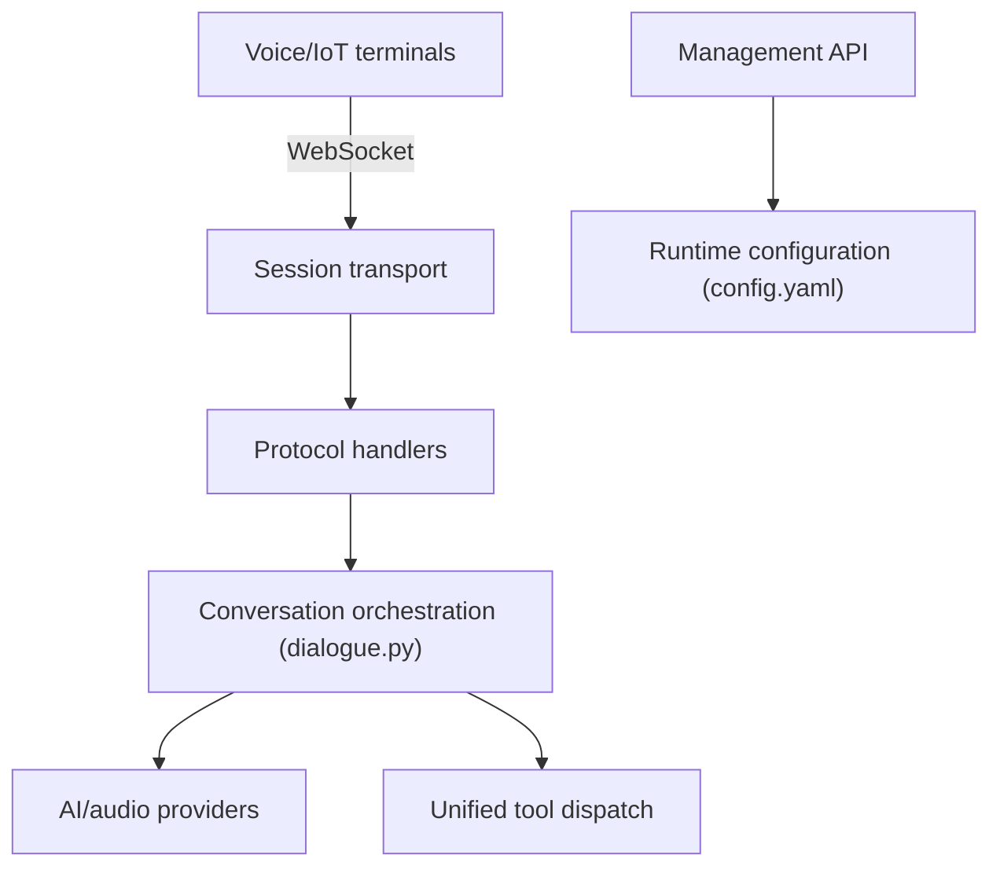

# xinnan-tech/xiaozhi-esp32-server

> Open-source backend server for Xiaozhi ESP32 voice terminals: recognition, LLM, speech synthesis and a management console.

## The problem
Xiaozhi devices depend on a hosted backend; you need a server of your own to drive voice and connected objects.

## What it actually does
A Python server receives audio and text over WebSocket (or MQTT+UDP) and chains VAD, speech recognition, dialogue, LLM and speech synthesis, with memory, voiceprint, intents and tools (IoT, MCP, plugins). A full installation adds a Java/Spring management API, a database, Redis, RAGFlow and Vue web and mobile consoles. Two profiles: free (FunASR, glm-4-flash, EdgeTTS) and streaming (iFlytek, Alibaba, Volcengine).

## How it is wired

## Trying it
The detailed commands are in the deployment documentation (Docker or source), not reproduced in the README; the README only mentions `python performance_tester.py` to test model speed.

## Cost and gotchas
Requires an ESP32 device. Third-party APIs (LLM, ASR, TTS) may be paid; local FunASR uses a lot of memory. The README states that the project has not undergone a security evaluation and must not be used in production.

## What it is not
Not usable without ESP32 hardware. README mostly in Chinese.

## Alternatives
No alternative named in the README.

## For you
Worth watching: a rich example of a complete voice pipeline, useful to study, but to be reserved for experimentation and architecture reading.
