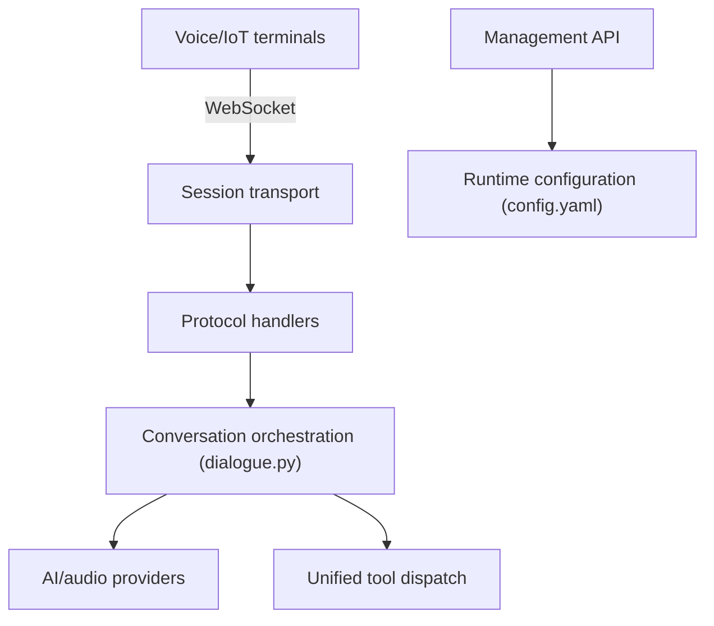

# xinnan-tech/xiaozhi-esp32-server

> Serveur backend libre pour les terminaux vocaux ESP32 Xiaozhi : reconnaissance, LLM, synthèse et console de gestion.

## Le problème
Les appareils Xiaozhi dépendent d'un backend hébergé ; il faut un serveur à soi pour piloter la voix et les objets connectés.

## Ce que ça fait vraiment
Un serveur Python reçoit audio et texte par WebSocket (ou MQTT+UDP), enchaîne VAD, reconnaissance vocale, dialogue, LLM, synthèse vocale, avec mémoire, voiceprint, intentions et outils (IoT, MCP, plugins). Une installation complète ajoute une API de gestion Java/Spring, une base de données, Redis, RAGFlow et des consoles Vue web et mobile. Deux profils : gratuit (FunASR, glm-4-flash, EdgeTTS) et flux (iFlytek, Alibaba, Volcengine).

## Comment c'est branché

## Essayer
Les commandes détaillées sont dans la documentation de déploiement (Docker ou source), non reproduites dans le README ; le README cite seulement `python performance_tester.py` pour tester la vitesse des modèles.

## Coût et pièges
Nécessite un appareil ESP32. Les API tierces (LLM, ASR, TTS) peuvent être payantes ; FunASR local consomme beaucoup de mémoire. Le README précise que le projet n'a pas passé d'évaluation de sécurité et ne doit pas être utilisé en production.

## Ce que ce n'est pas
Pas utilisable sans matériel ESP32. README principalement en chinois.

## Alternatives
Aucune alternative nommée dans le README.

## Pour toi
À surveiller : exemple riche de pipeline vocal complet, utile à étudier, mais à réserver à l'expérimentation et à la lecture d'architecture.

