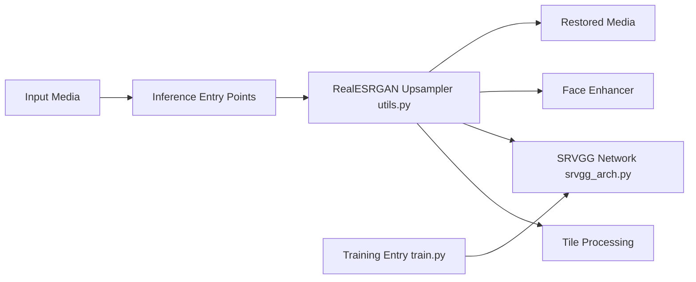

# xinntao/Real-ESRGAN

> Models and scripts for super-resolution of real-world images and videos, for vision researchers and practitioners.

## The problem
Enlarging a degraded image (compression, blur, noise) produces artifacts with classical methods.

## What it actually does
Networks trained on synthetic degradations (ICCVW 2021 paper, Tencent ARC) to upscale x2 to x4.
Image or video inference, tiled or whole-image, with optional face enhancement via GFPGAN.
General and anime models; portable NCNN-Vulkan executables with no CUDA or PyTorch.
Training via BasicSR on synthetic or paired datasets.

## How it is wired


## Trying it
```bash
git clone https://github.com/xinntao/Real-ESRGAN.git
cd Real-ESRGAN
pip install basicsr
pip install facexlib
pip install gfpgan
pip install -r requirements.txt
python setup.py develop
wget https://github.com/xinntao/Real-ESRGAN/releases/download/v0.1.0/RealESRGAN_x4plus.pth -P weights
python inference_realesrgan.py -n RealESRGAN_x4plus -i inputs --face_enhance
```

## Cost and gotchas
A GPU is recommended for the Python script; the NCNN executable can create inconsistencies between tiles. Last push in August 2024, 647 open issues.

## What it is not
Not a faithful restoration: the model invents detail. Not an actively maintained library; the executable does not handle every option (`outscale`).

## Alternatives
- Real-ESRGAN-ncnn-vulkan: portable binary with no Python environment.
- Upscayl: graphical interface built on this model.
- Waifu2x-Extension-GUI: multi-engine GUI for anime.

## For you
A reliable upscaling building block to integrate into an image pipeline; frozen, but still a reference.
