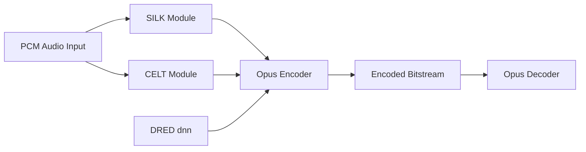

# xiph/opus

> Reference implementation of the Opus audio codec for interactive voice and audio over the Internet.

## The problem
Real-time voice over a packet-losing network requires a low-latency, robust codec.

## What it actually does
C library that encodes and decodes Opus streams (SILK and CELT layers, from narrowband voice to stereo music). Since 1.5, DRED is a deep-learning redundancy encoder that slips one second of recovery data into packet padding, backward compatible with earlier versions.

## How it is wired


## Trying it
```bash
./autogen.sh
./configure
make
make check
```

## Cost and gotchas
Git repository: autotools required. License present but not identified by GitHub; the README refers to the COPYING file (royalty-free patent and copyright licenses).

## What it is not
Not a file format: to store audio, use the Ogg encapsulation (opus-tools). The streams from the test tools are not meant for distribution.

## Alternatives
- opus-tools: encoding/decoding of Ogg Opus files.

## For you
Worth watching: a building block to know for voice and real time, DRED is the AI point of interest; direct use remains rare.
