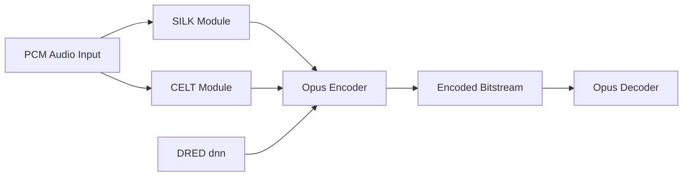

# xiph/opus

> Implémentation de référence du codec audio Opus pour voix et audio interactifs sur Internet.

## Le problème
La voix en temps réel sur réseau perdant des paquets exige un codec à faible latence et robuste.

## Ce que ça fait vraiment
Bibliothèque C qui encode et décode des flux Opus (couches SILK et CELT, de la voix bande étroite à la musique stéréo). Depuis la 1.5, DRED est un encodeur de redondance par apprentissage profond qui glisse une seconde de données de récupération dans le remplissage des paquets, compatible avec les versions antérieures.

## Comment c'est branché


## Essayer
```bash
./autogen.sh
./configure
make
make check
```

## Coût et pièges
Dépôt Git : autotools requis. Licence présente mais non identifiée par GitHub ; le README renvoie au fichier COPYING (licences gratuites de brevet et de droit d'auteur).

## Ce que ce n'est pas
Pas un format de fichier : pour stocker, utiliser l'encapsulation Ogg (opus-tools). Les flux des outils de test ne servent pas à la distribution.

## Alternatives
- opus-tools : encodage/décodage de fichiers Ogg Opus.

## Pour toi
À surveiller : brique à connaître pour la voix et le temps réel, DRED est le point d'intérêt IA ; l'usage direct reste rare.

