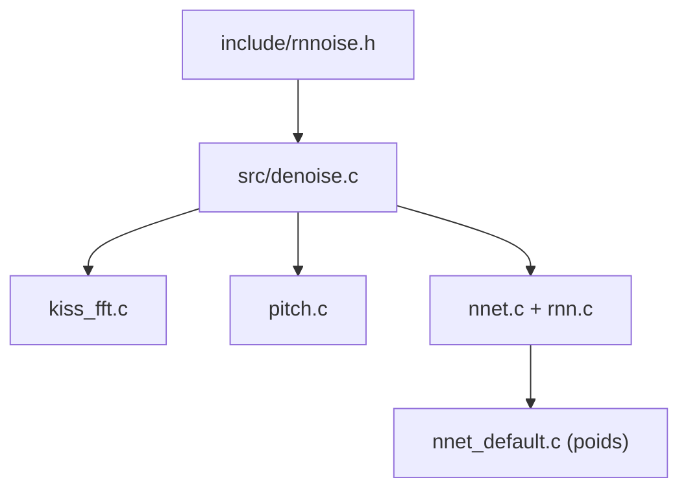

# xiph/rnnoise

> C library for real-time voice noise suppression, combining signal processing and a recurrent network.

## The problem
Background noise degrades voice for calls, transcription and recording, and classic filters cut poorly.

## What it actually does
Denoises mono speech at 48 kHz in real time: extraction of spectral and pitch features, inference of a small recurrent network, then filtering. A sample CLI processes raw 16-bit PCM files. A PyTorch training pipeline (dump_features, train_rnnoise.py) lets you retrain and then export the weights to C.

## How it is wired


## Trying it
```bash
./autogen.sh
./configure
make
./examples/rnnoise_demo
```

## Cost and gotchas
Free. Autogen downloads the models from the Xiph servers. Input and output are raw PCM, not WAV. To retrain, you need voice and noise corpora at 48 kHz. Last push in February 2025, GitHub is only a copy of the Xiph repository.

## What it is not
Not a ready-to-use tool for WAV or MP3 files, and not a source separation model.

## Alternatives
No alternative named in the README.

## For you
Adopt: a light, proven building block to clean audio before speech recognition, and a good example of a training-to-embedded pipeline.
