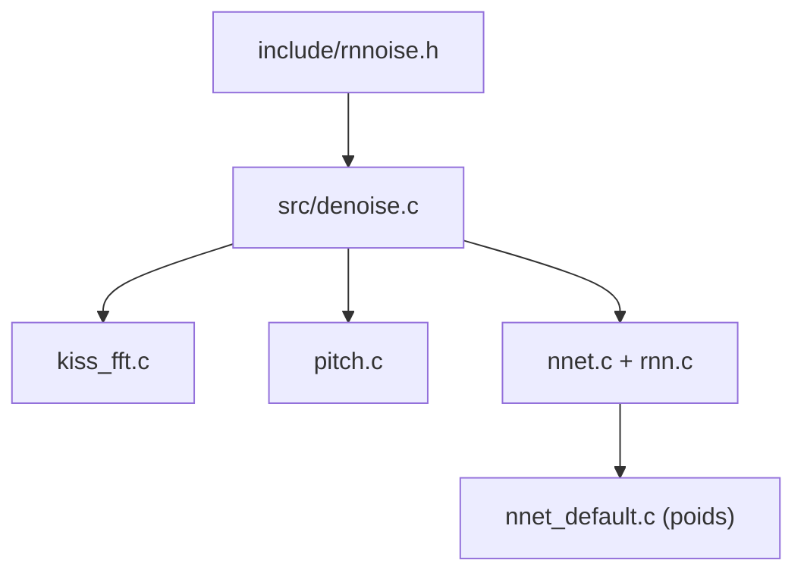

# xiph/rnnoise

> Bibliothèque C de suppression de bruit vocal en temps réel, mêlant traitement du signal et réseau récurrent.

## Le problème
Le bruit de fond dégrade la voix pour les appels, la transcription et l'enregistrement, et les filtres classiques coupent mal.

## Ce que ça fait vraiment
Débruite en temps réel de la parole mono à 48 kHz : extraction de caractéristiques spectrales et de hauteur, inférence d'un petit réseau récurrent, puis filtrage. Une CLI d'exemple traite des fichiers PCM bruts 16 bits. Un pipeline d'entraînement PyTorch (dump_features, train_rnnoise.py) permet de réentraîner puis d'exporter les poids en C.

## Comment c'est branché


## Essayer
```bash
./autogen.sh
./configure
make
./examples/rnnoise_demo
```

## Coût et pièges
Gratuit. L'autogen télécharge les modèles depuis les serveurs Xiph. L'entrée et la sortie sont du PCM brut, pas du WAV. Pour réentraîner, il faut des corpus de voix et de bruit à 48 kHz. Dernier push en février 2025, GitHub n'est qu'une copie du dépôt Xiph.

## Ce que ce n'est pas
Pas un outil prêt à l'emploi pour des fichiers WAV ou MP3, et pas un modèle de séparation de sources.

## Alternatives
Aucune alternative nommée dans le README.

## Pour toi
À adopter : brique légère et éprouvée pour nettoyer l'audio avant reconnaissance vocale, et bon exemple de pipeline entraînement-vers-embarqué.

