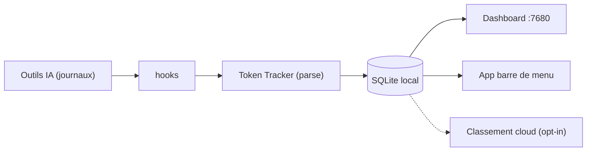

# xiufengsun/TokenTracker

> A local dashboard of token consumption and costs for 43 AI coding tools.

## The problem
Tokens and the bill are scattered across Claude Code, Codex, Cursor, Gemini and other tools.

## What it actually does
Hooks read the tools' local logs, extract token counts, timestamps and models, aggregate them in 30-minute UTC buckets in a SQLite database and feed a web dashboard, a menu bar app (macOS, Windows, Linux) and widgets. Cost comes from LiteLLM (2,200+ models). Leaderboard and cloud sync are optional. Anonymous telemetry is on by default.

## How it is wired


## Trying it
```bash
npx tokentracker-cli
tokentracker status
tokentracker doctor
```

## Cost and gotchas
Free, no account. Node 20+. Hooks are installed into your tools; `tokentracker uninstall` removes them. Disable telemetry: `TOKENTRACKER_NO_TELEMETRY=1`.

## What it is not
It is not an official provider bill counter; models with no published price show $0. The macOS app is ad hoc signed, not notarized.

## Alternatives
- ccusage: reporting CLI, stronger in the terminal.
- Tokscale: multi-agent TUI and CLI.

## For you
Adopt if you use several coding agents: local, keyless, and it monitors a cost you pay.
