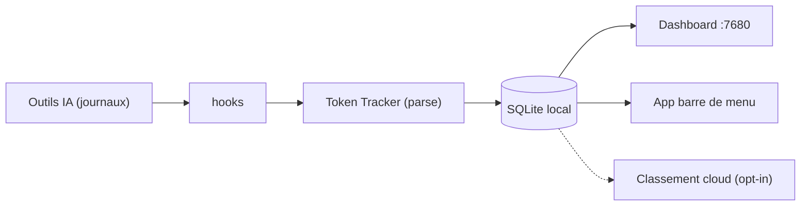

# xiufengsun/TokenTracker

> Tableau de bord local de consommation de tokens et de coûts pour 43 outils de code IA.

## Le problème
Les tokens et la facture sont éclatés entre Claude Code, Codex, Cursor, Gemini et d'autres outils.

## Ce que ça fait vraiment
Des hooks lisent les journaux locaux des outils, extraient comptes de tokens, horodatages et modèles, agrègent par tranches de 30 minutes UTC dans une base SQLite et alimentent un tableau de bord web, une app de barre de menu (macOS, Windows, Linux) et des widgets. Le coût vient de LiteLLM (2 200+ modèles). Classement et synchronisation cloud sont optionnels. Une télémétrie anonyme est active par défaut.

## Comment c'est branché


## Essayer
```bash
npx tokentracker-cli
tokentracker status
tokentracker doctor
```

## Coût et pièges
Gratuit, sans compte. Node 20+. Les hooks s'installent dans tes outils ; `tokentracker uninstall` les retire. Désactiver la télémétrie : `TOKENTRACKER_NO_TELEMETRY=1`.

## Ce que ce n'est pas
Ce n'est pas un compteur de facture officielle des fournisseurs ; les modèles sans tarif publié affichent 0 $. App macOS signée ad hoc, non notariée.

## Alternatives
- ccusage : CLI de reporting, plus fort en terminal.
- Tokscale : TUI et CLI multi-agents.

## Pour toi
À adopter si tu utilises plusieurs agents de code : local, sans clé, et il surveille un coût que tu paies.

