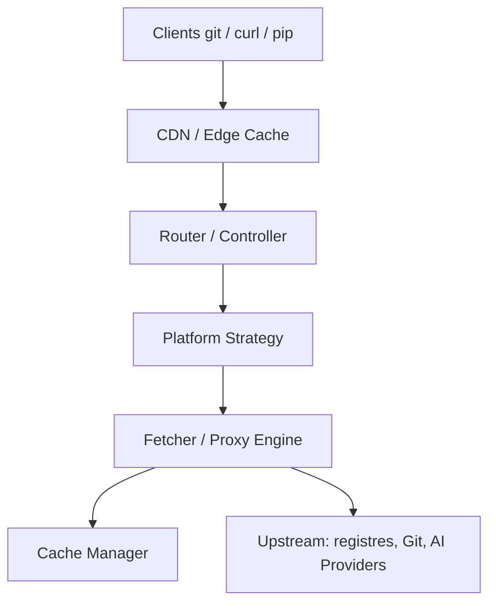

# xixu-me/Xget

> Acceleration proxy for Git repositories, package registries, models, containers and AI APIs, deployable on Cloudflare Workers.

## The problem
Downloads of code, packages, models and container images are slow or blocked from some regions.

## What it actually does
A Worker recognizes a platform prefix (`gh`, `hf`, `pypi`, `npm`, `cr/ghcr`, `ip/openai`…), rewrites the URL, queries the upstream with retries (3 max) and a 30 s timeout, caches compatible responses (not Git operations) and adds security headers and `X-Performance-Metrics`. It also covers Hugging Face (`HF_ENDPOINT`), Civitai and the OpenAI, Anthropic and Gemini APIs.

## How it is wired


## Trying it
```bash
git clone https://xget.xi-xu.me/gh/microsoft/vscode.git
pip install requests -i https://xget.xi-xu.me/pypi/simple/
docker run -d --name xget -p 8080:8080 ghcr.io/xixu-me/xget:latest
```

## Cost and gotchas
The Worker requires a Cloudflare account (or Vercel, Netlify, EdgeOne) and GitHub secrets; self-hosting with Docker loses the edge acceleration. The public instance is "for trial use only". API keys would go through an intermediary: protect it with authentication or an IP allowlist.

## What it is not
Not a reliable mirror for production if you rely on the public instance. The catalog declares no license, while the README announces AGPL-3.0 (network copyleft): check before any use.

## Alternatives
No alternative named in the README.

## For you
Worth watching: useful to speed up HF, PyPI, conda and containers from a slow network, but self-hosted behind authentication, never the public instance with API keys.
