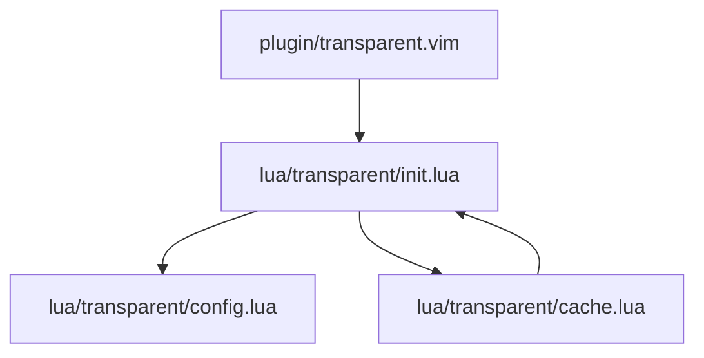

# xiyaowong/transparent.nvim

> Neovim plugin that clears background colors to make the editor transparent.

## The problem
Neovim themes force an opaque background that hides the terminal's image or color.

## What it actually does
It clears highlight groups (Normal, Comment, LineNr, etc.) to let the terminal show through. The list can be extended or reduced, including via a function, and a whole prefix can be cleared for UI plugins. State is cached and reapplied on the next startup.

## How it is wired


## Trying it
```lua
require("transparent").setup({ extra_groups = { "NormalFloat" } })
```
Commands: `:TransparentEnable`, `:TransparentDisable`, `:TransparentToggle`.

## Cost and gotchas
Free. Avoid lazy-loading the plugin. Transparent floating windows render poorly.

## What it is not
Not a color theme: it only removes backgrounds. It does not set the terminal's own transparency.

## Alternatives
No alternative named in the README.

## For you
Ignore: an aesthetic gadget for Neovim, with no effect on your data / AI / MLOps productivity.
