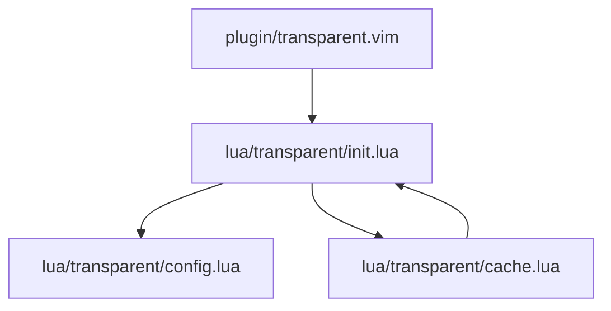

# xiyaowong/transparent.nvim

> Plugin Neovim qui efface les couleurs de fond pour rendre l'éditeur transparent.

## Le problème
Les thèmes Neovim imposent un fond opaque qui masque l'image ou la couleur du terminal.

## Ce que ça fait vraiment
Il vide les groupes de surbrillance (Normal, Comment, LineNr, etc.) pour laisser voir le terminal. La liste peut être étendue ou réduite, y compris par fonction, et un préfixe entier peut être effacé pour les plugins d'interface. L'état est mis en cache et réappliqué au démarrage suivant.

## Comment c'est branché


## Essayer
```lua
require("transparent").setup({ extra_groups = { "NormalFloat" } })
```
Commandes : `:TransparentEnable`, `:TransparentDisable`, `:TransparentToggle`.

## Coût et pièges
Gratuit. Éviter le chargement différé du plugin. Les fenêtres flottantes transparentes rendent mal.

## Ce que ce n'est pas
Pas un thème de couleurs : il ne fait que retirer les fonds. Ne règle pas la transparence du terminal lui-même.

## Alternatives
Aucune alternative nommée dans le README.

## Pour toi
Ignorer : un gadget esthétique pour Neovim, sans effet sur ta productivité data / IA / MLOps.

