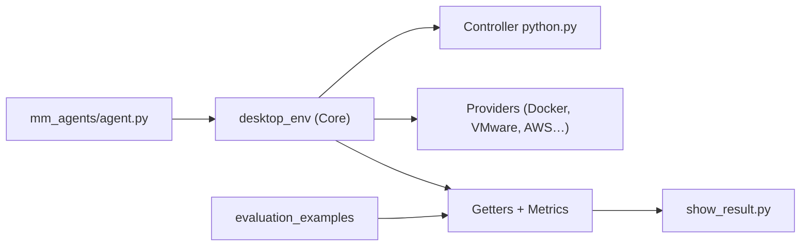

# xlang-ai/OSWorld

> Benchmark for multimodal agents on real virtualized desktops (Ubuntu, Windows).

## The problem
Measuring whether an agent can accomplish real tasks (LibreOffice, Chrome, Thunderbird) requires a reproducible environment and automatic evaluators.

## What it actually does
`DesktopEnv` starts a VM through a provider (VMware, VirtualBox, Docker, AWS, Modal, Daytona); an agent sends actions (pyautogui); "getters" and "metrics" compare the final state to the expected one, on per-application JSON examples. A reference GPT-4o agent working from screenshots is provided. Results aggregated by domain with `show_result.py`. A public evaluation goes through a meeting with the maintainers.

## How it is wired


## Trying it
```bash
git clone https://github.com/xlang-ai/OSWorld
cd OSWorld
pip install -r requirements.txt
python quickstart.py --provider_name vmware --path_to_vm "path/to/your/vm.vmx"
python scripts/python/run_multienv.py --provider_name docker --headless --observation_type screenshot --model gpt-4o --num_envs 10 --client_password password
```

## Cost and gotchas
Heavy VMs (hypervisor or Docker, or billed cloud). OpenAI key for the base agent. Some tasks require a Google account (OAuth) and a proxy; without them scores drop. Clean up leftover containers after an interruption.

## What it is not
Not an agent: it is a measuring bench. A local score is not on the verified leaderboard until the maintainers have replayed it.

## Alternatives
`OSWorld-MCP` (same team, evaluates MCP tool use), cited in the README.

## For you
Watch: a reference for evaluating "computer use" agents, but costly to set up; pull it back out if you compare agents.
