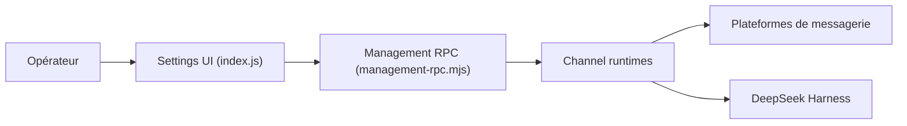

# xmanrui/dsh-im

> DeepSeek Harness plugin that connects messaging bots (WeChat, Feishu, Slack…) to a local Harness.

## The problem
Talking to your DeepSeek Harness agent from a messaging app requires writing one gateway per platform.

## What it actually does
- Handles 12 channels: Feishu, WeChat, DingTalk, WeCom, QQ, Slack, Telegram, Discord, WhatsApp, iMessage, Matrix (experimental) and an "AI Office" connector.
- Several bots per channel, each with its own workspace, model and session; commands `/new`, `/model`, `/stop`, `/steer`…
- Response streaming, sending and receiving images and files, 14-day archiving of group messages, remote approvals.
- Controlled from "Settings → IM机器人".

## How it is wired


## Trying it
```bash
dsh plugin --profile desktop add -w @xmanrui/dsh-im
dsh plugin --profile web add -w @xmanrui/dsh-im
npm install
npm run check
```

## Cost and gotchas
Free plugin, but you need DeepSeek Harness, accounts/bots on each platform (sometimes requiring approval) and the model cost. Matrix: unreliable encryption. README in Chinese.

## What it is not
Not a standalone product: useless without DeepSeek Harness (version `0.2.1-rc.2` targeted). The README is mostly a configuration manual.

## Alternatives
No alternative named in the README.

## For you
Ignore: tightly tied to the DeepSeek Harness ecosystem and to Chinese messaging apps; only if you already use it.
