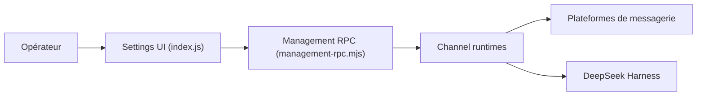

# xmanrui/dsh-im

> Plugin DeepSeek Harness qui relie des bots de messagerie (WeChat, Feishu, Slack…) à un Harness local.

## Le problème
Parler à son agent DeepSeek Harness depuis une messagerie demande d'écrire une passerelle par plateforme.

## Ce que ça fait vraiment
- Gère 12 canaux : Feishu, WeChat, DingTalk, WeCom, QQ, Slack, Telegram, Discord, WhatsApp, iMessage, Matrix (expérimental) et un connecteur « AI Office ».
- Plusieurs bots par canal, chacun avec son espace de travail, son modèle et sa session ; commandes `/new`, `/model`, `/stop`, `/steer`…
- Streaming des réponses, envoi et réception d'images et de fichiers, archivage des messages de groupe 14 jours, approbations à distance.
- Se pilote depuis « Réglages → IM机器人 ».

## Comment c'est branché


## Essayer
```bash
dsh plugin --profile desktop add -w @xmanrui/dsh-im
dsh plugin --profile web add -w @xmanrui/dsh-im
npm install
npm run check
```

## Coût et pièges
Plugin gratuit, mais il faut DeepSeek Harness, des comptes/robots par plateforme (parfois approbation) et le coût du modèle. Matrix : chiffrement non fiable. README en chinois.

## Ce que ce n'est pas
Pas un produit autonome : inutile sans DeepSeek Harness (version `0.2.1-rc.2` visée). Le README est surtout un mode d'emploi de configuration.

## Alternatives
Aucune alternative nommée dans le README.

## Pour toi
À ignorer : très lié à l'écosystème DeepSeek Harness et à des messageries chinoises ; seulement si tu l'utilises déjà.

