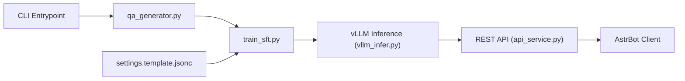

# xming521/WeClone

> Full pipeline to fine-tune an LLM on your chat history and deploy it as a bot.

## The problem
Creating a "digital twin" that writes like you means exporting, cleaning and anonymizing conversations, then fine-tuning and serving a model.

## What it actually does
`make-dataset` turns a Telegram JSON export into question-answer pairs, with personal data filtering by Microsoft Presidio and a blocked-words list.
`train-sft` fine-tunes Qwen2.5-VL-7B-Instruct with LoRA via LLaMA Factory; DeepSpeed for multi-GPU.
`server` exposes an OpenAI-compatible API; `webchat-demo` for testing.
Hooks into AstrBot or LangBot for Discord, Telegram, Slack.

## How it is wired


## Trying it
```bash
git clone https://github.com/xming521/WeClone.git && cd WeClone
uv venv .venv --python=3.12
uv pip install --group main -e .
cp examples/tg.template.jsonc settings.jsonc
weclone-cli make-dataset
weclone-cli train-sft
weclone-cli server
```

## Cost and gotchas
GPU required: about 16 GB of VRAM for LoRA on a 7B, CUDA 12.6+. The README shows a third-party API sponsor, not needed for it to work.

## What it is not
Not a production tool: the README says so itself. Presidio does not guarantee complete anonymization. Tool calls no longer work after fine-tuning. AGPL-3.0.

## Alternatives
- LLaMA-Factory: the fine-tuning engine used, to be taken directly for other data.
- AstrBot / LangBot: only for the bot part.

## For you
Worth watching as an end-to-end example (data → LoRA → OpenAI-compatible API), but consent and privacy questions limit its interest beyond experimentation.
