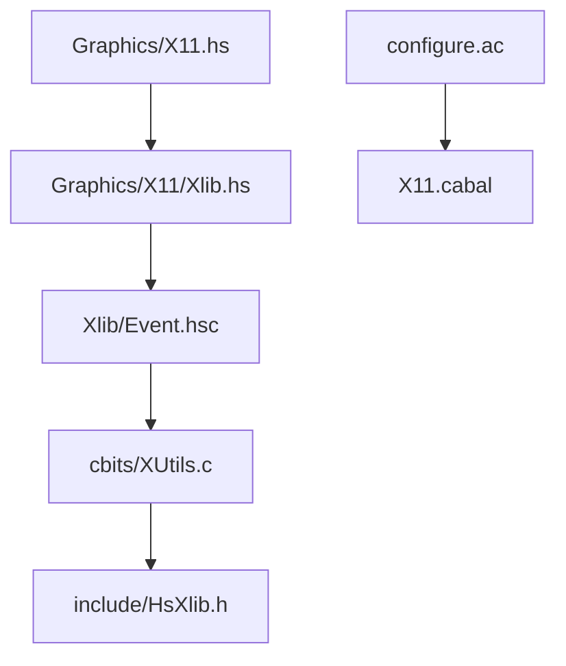

# xmonad/X11

> Haskell binding to the X11 graphics library, for Haskell developers, notably xmonad.

## The problem
Calling Xlib and its extensions from Haskell requires maintained C bindings.

## What it actually does
Exposes Xlib and its extensions (including Xrandr) via `.hsc` files backed by C code and headers. `configure.ac` and `X11.cabal` detect the libraries; Xinerama support is enabled by default if the headers exist.

## How it is wired


## Trying it
```bash
cabal configure
cabal build
cabal install
# depuis Git : autoreconf avant la compilation
```

## Cost and gotchas
Free. Requires Cabal (Haskell), autoconf from Git, and the X11, xrandr and XScreenSaver development libraries. License not identified by GitHub.

## What it is not
Not a window manager: it is the binding layer that one uses.

## Alternatives
No alternative named in the README.

## For you
Ignore: low-level Haskell/X11 unrelated to your work.
