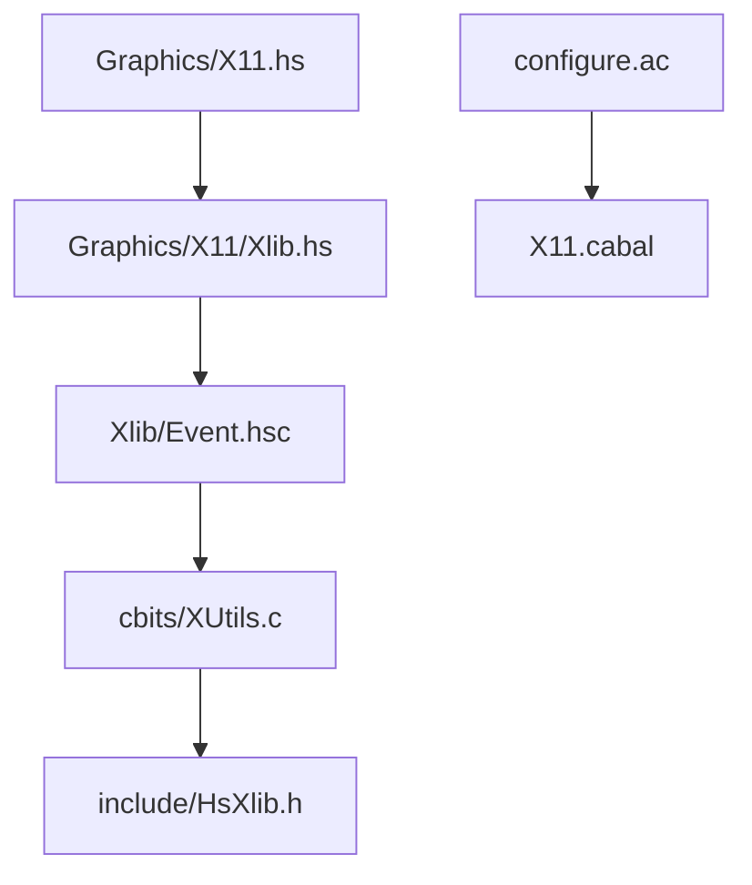

# xmonad/X11

> Liaison Haskell à la bibliothèque graphique X11, pour développeurs Haskell, notamment xmonad.

## Le problème
Appeler Xlib et ses extensions depuis Haskell demande des liaisons C maintenues.

## Ce que ça fait vraiment
Expose Xlib et ses extensions (dont Xrandr) via des fichiers `.hsc` appuyés par du code C et des en-têtes. `configure.ac` et `X11.cabal` détectent les bibliothèques ; le support Xinerama est activé par défaut si les en-têtes existent.

## Comment c'est branché


## Essayer
```bash
cabal configure
cabal build
cabal install
# depuis Git : autoreconf avant la compilation
```

## Coût et pièges
Gratuit. Exige Cabal (Haskell), autoconf depuis Git et les bibliothèques de développement X11, xrandr, XScreenSaver. Licence non identifiée par GitHub.

## Ce que ce n'est pas
Pas un gestionnaire de fenêtres : c'est la brique de liaison qu'il utilise.

## Alternatives
Aucune alternative nommée dans le README.

## Pour toi
Ignorer : bas niveau Haskell/X11 sans lien avec ton métier.

