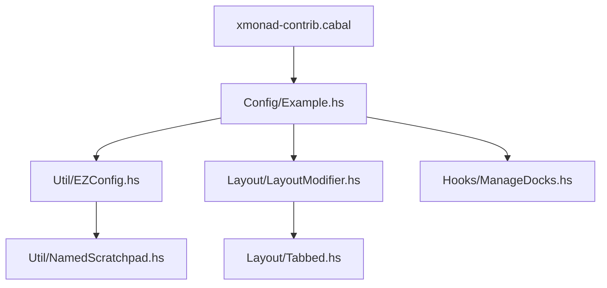

# xmonad/xmonad-contrib

> Hundreds of community modules (layouts, hooks, prompts) for the xmonad window manager.

## The problem
The xmonad core is minimal; advanced layouts and behaviors are missing.

## What it actually does
A Haskell library declared in `xmonad-contrib.cabal`. A config such as `Example.hs` combines layouts (`LayoutModifier`, `Tabbed`), hooks (`ManageDocks`, `EwmhDesktops`, `StatusBar`), actions and prompts; `EZConfig` simplifies key bindings, `NamedScratchpad` adds scratchpads.

## How it is wired

## Trying it
No command in the README: it points to the xmonad website (download, installation, tutorial).

## Cost and gotchas
Free. Haskell and X11 required: neither Wayland nor macOS benefit from it.

## What it is not
It is not a standalone window manager: it extends xmonad.

## Alternatives
No alternative named in the README.

## For you
Ignore unless you already use xmonad: no link with data / AI work.
