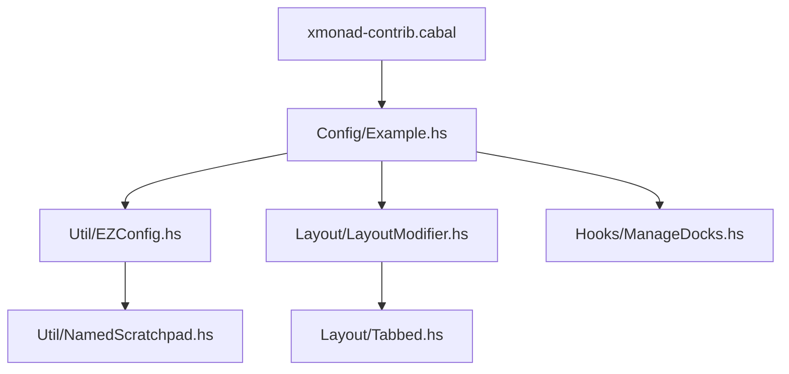

# xmonad/xmonad-contrib

> Centaines de modules communautaires (dispositions, hooks, invites) pour le gestionnaire de fenêtres xmonad.

## Le problème
Le noyau d'xmonad est minimal ; les dispositions et comportements avancés manquent.

## Ce que ça fait vraiment
Bibliothèque Haskell déclarée dans `xmonad-contrib.cabal`. Une config comme `Example.hs` combine des dispositions (`LayoutModifier`, `Tabbed`), des hooks (`ManageDocks`, `EwmhDesktops`, `StatusBar`), des actions et des invites ; `EZConfig` simplifie la liaison des touches, `NamedScratchpad` ajoute des scratchpads.

## Comment c'est branché

## Essayer
Aucune commande dans le README : il renvoie vers le site xmonad (téléchargement, installation, tutoriel).

## Coût et pièges
Gratuit. Haskell et X11 nécessaires : ni Wayland ni macOS n'en profitent.

## Ce que ce n'est pas
Ce n'est pas un gestionnaire de fenêtres autonome : il étend xmonad.

## Alternatives
Aucune alternative nommée dans le README.

## Pour toi
À ignorer sauf si tu es déjà utilisateur xmonad : aucun lien avec le travail data / IA.

