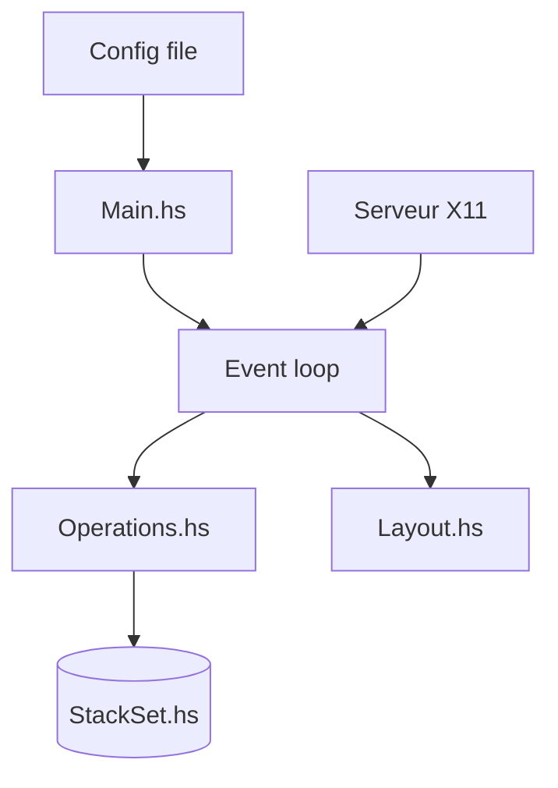

# xmonad/xmonad

> Tiling window manager for X11, configured and extended in Haskell.

## The problem
Placing and resizing windows with the mouse wastes screen space and time.

## What it actually does
- Arranges windows automatically with no gaps or overlap.
- Everything is controlled from the keyboard; the mouse is optional.
- Dynamic layouts, one per workspace; Xinerama for multiple screens.
- Configuration in Haskell, extended by xmonad-contrib.

## How it is wired

## Trying it
No command in the README: it points to the download and tutorial pages of the xmonad.org site.

## Cost and gotchas
Free. Real requirement: a Haskell toolchain for the configuration, and an X11 environment.

## What it is not
Not a full desktop environment, and not for Wayland (the README talks about X11). The internal relations come mostly from the repository structure.

## Alternatives
No alternative named in the README (xmonad-contrib is its extension).

## For you
Ignore: a personal workstation choice, with no effect on your data / AI projects.
