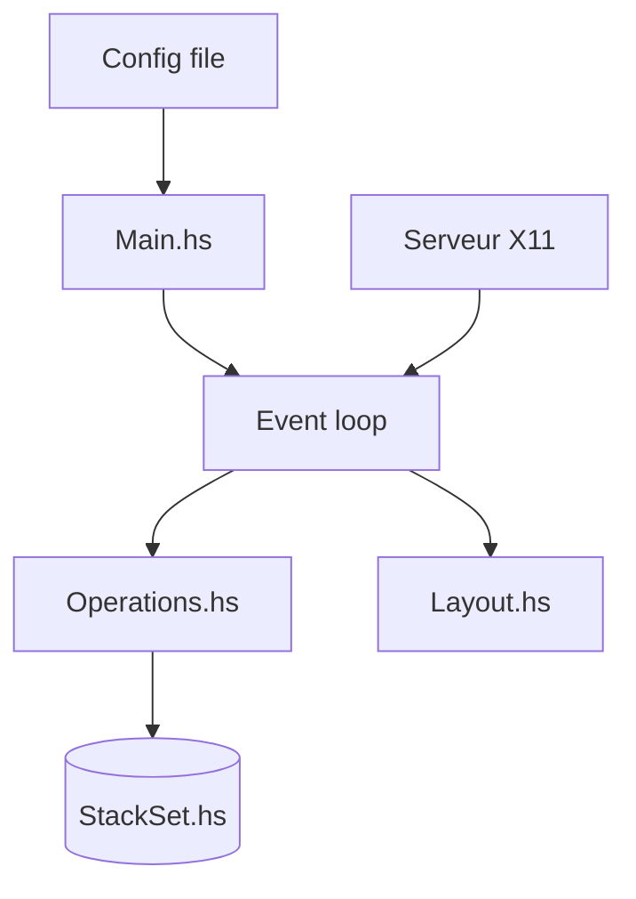

# xmonad/xmonad

> Gestionnaire de fenêtres en mosaïque pour X11, configuré et étendu en Haskell.

## Le problème
Placer et redimensionner des fenêtres à la souris fait perdre de la place d'écran et du temps.

## Ce que ça fait vraiment
- Arrange les fenêtres automatiquement sans trous ni recouvrement.
- Tout se commande au clavier ; la souris est facultative.
- Mises en page dynamiques, une par espace de travail ; Xinerama pour plusieurs écrans.
- Configuration en Haskell, étendue par xmonad-contrib.

## Comment c'est branché

## Essayer
Aucune commande dans le README : il renvoie aux pages de téléchargement et de tutoriel du site xmonad.org.

## Coût et pièges
Gratuit. Besoin réel : un toolchain Haskell pour la configuration, et un environnement X11.

## Ce que ce n'est pas
Pas un environnement de bureau complet, ni pour Wayland (le README parle de X11). Les relations internes viennent surtout de la structure du dépôt.

## Alternatives
Aucune alternative nommée dans le README (xmonad-contrib est son extension).

## Pour toi
À ignorer : choix de poste de travail personnel, sans effet sur tes projets data / IA.

