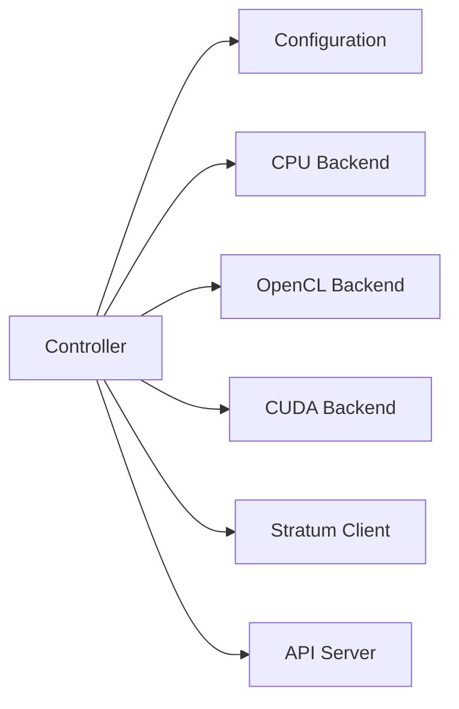

# xmrig/xmrig

> CPU/GPU cryptocurrency miner (RandomX, KawPow, CryptoNight, GhostRider) for miners.

## The problem
Mining cryptocurrencies requires software suited to each algorithm and each type of hardware.

## What it actually does
Mining program with CPU, OpenCL (AMD) and CUDA (NVIDIA via an external plugin) backends, configured through a JSON file, with an HTTP API and a configuration wizard. Also serves as a RandomX benchmark.

## How it is wired


## Trying it
```bash
# Binaires ou compilation depuis les sources ; configuration par fichier JSON. Aucune commande dans le README.
```

## Cost and gotchas
Free software, but mining consumes electricity and hardware. A default 1% donation (1 minute out of 100) is active; adjustable via `donate-level`.

## What it is not
Not a data or AI tool. Profitability is not documented.

## Alternatives
No alternative named in the README.

## For you
Ignore: cryptocurrency mining, outside your data/AI/MLOps work.
