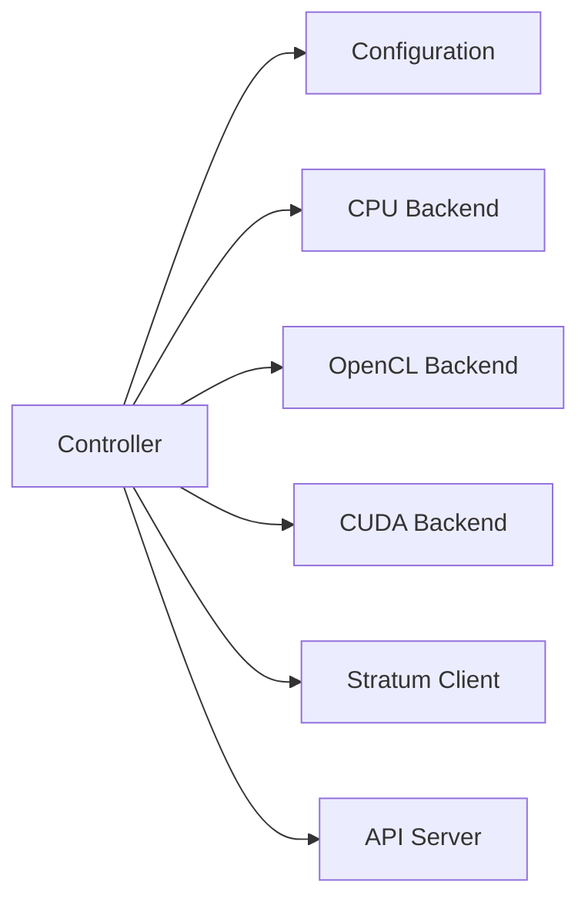

# xmrig/xmrig

> Mineur de cryptomonnaie CPU/GPU (RandomX, KawPow, CryptoNight, GhostRider) pour mineurs.

## Le problème
Miner des cryptomonnaies demande un logiciel adapté à chaque algorithme et à chaque matériel.

## Ce que ça fait vraiment
Programme de minage avec backends CPU, OpenCL (AMD) et CUDA (NVIDIA via plugin externe), configuré par fichier JSON, avec API HTTP et assistant de configuration. Sert aussi de benchmark RandomX.

## Comment c'est branché


## Essayer
```bash
# Binaires ou compilation depuis les sources ; configuration par fichier JSON. Aucune commande dans le README.
```

## Coût et pièges
Logiciel gratuit, mais le minage consomme électricité et matériel. Une donation par défaut de 1 % (1 minute sur 100) est active ; réglable via `donate-level`.

## Ce que ce n'est pas
Pas un outil de data ou d'IA. Rentabilité non documentée.

## Alternatives
Aucune alternative nommée dans le README.

## Pour toi
À ignorer : minage de cryptomonnaie, hors de ton métier data/IA/MLOps.

