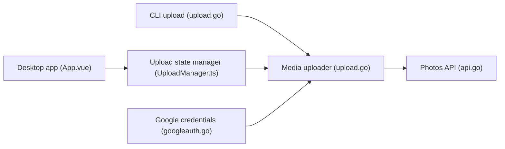

# xob0t/gotohp

> Unofficial desktop client for uploading photos to Google Photos, with a CLI mode.

## The problem
Bulk-uploading photos to Google Photos from a computer is limited by the official tools.

## What it actually does
Drag-and-drop interface and CLI: upload of files or folders (recursive), adjustable thread count, real-time progress, files already present are skipped, multiple account management. It uses credentials obtained through Google's Embedded Setup page (`oauth_token` cookie), a ReVanced APK or a rooted device. The GUI is built on Wails; the CLI shares the configuration file.

## How it is wired


## Trying it
```bash
gotohp-cli upload /path/to/photos --recursive --threads 5
gotohp-cli creds add "<oauth_token cookie value>"
gotohp-cli creds set user@gmail.com
```

## Cost and gotchas
Free, but obtaining the credentials is manual (browser developer tools, ADB, network interception). Nothing guarantees that Google will let the client keep working; the risk to the account is not documented.

## What it is not
Not an official Google client. The README does not detail what "unlimited uploads" implies for quota.

## Alternatives
No alternative named in the README.

## For you
Ignore: a fragile workaround of a proprietary service, with no obvious use for your data pipelines.
