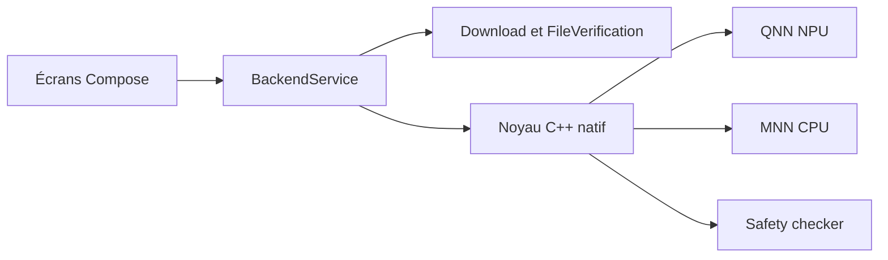

# xororz/local-dream

> Android app for local Stable Diffusion image generation, accelerated by the Snapdragon NPU.

## The problem
Generating images with Stable Diffusion on a phone is slow on CPU, and cloud services require an account and the sending of your prompts.

## What it actually does
Kotlin application with a C++ core: NPU inference via the Qualcomm QNN SDK (SD1.5 on Hexagon V68+, SDXL on Snapdragon 8 Gen 3+), or CPU/GPU via MNN. Handles model downloads, file verification, Real-ESRGAN/UltraSharp upscaling, NSFW filter. Guides and documentation moved to a separate site.

## How it is wired


## Trying it
```bash
# Aucune commande dans le README ; consulter le site de guide lié.
```

## Cost and gotchas
Free. The NPU requires a recent Snapdragon; large SDXL models need a lot of memory. The license is present but not identified by GitHub.

## What it is not
Not a general-purpose cross-platform interface: Android only, centered on SD1.5 and SDXL (SD2.1 dropped).

## Alternatives
- alibaba/MNN: CPU engine used internally.
- happyyzy/stable-diffusion.cpp: DiT optimizations cited as a dependency.

## For you
To ignore for everyday use, but useful as a reference for diffusion inference on an embedded NPU if you work on edge AI.
