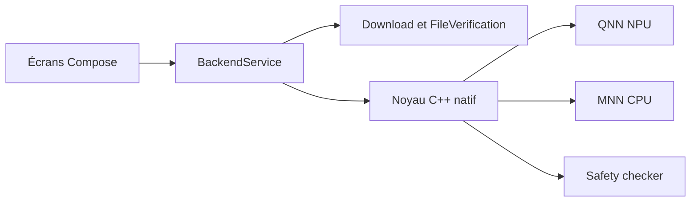

# xororz/local-dream

> Application Android de génération d'images Stable Diffusion locale, accélérée par le NPU Snapdragon.

## Le problème
Générer des images avec Stable Diffusion sur téléphone est lent sur CPU, et les services cloud exigent compte et envoi des prompts.

## Ce que ça fait vraiment
Application Kotlin avec noyau C++ : inférence NPU via le SDK Qualcomm QNN (SD1.5 sur Hexagon V68+, SDXL sur Snapdragon 8 Gen 3+), ou CPU/GPU via MNN. Gère téléchargement de modèles, vérification de fichiers, mise à l'échelle Real-ESRGAN/UltraSharp, filtre NSFW. Guides et documentation déplacés vers un site séparé.

## Comment c'est branché


## Essayer
```bash
# Aucune commande dans le README ; consulter le site de guide lié.
```

## Coût et pièges
Gratuit. Le NPU exige un Snapdragon récent ; les gros modèles SDXL demandent beaucoup de mémoire. La licence est présente mais non identifiée par GitHub.

## Ce que ce n'est pas
Pas une interface généraliste multiplateforme : Android seulement, centré sur SD1.5 et SDXL (SD2.1 abandonné).

## Alternatives
- alibaba/MNN : moteur CPU utilisé en interne.
- happyyzy/stable-diffusion.cpp : optimisations DiT citées en dépendance.

## Pour toi
À ignorer pour un usage courant, mais utile comme référence d'inférence de diffusion sur NPU embarqué si tu travailles sur de l'IA en périphérie.

