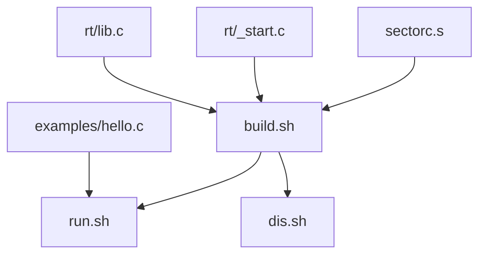

# xorvoid/sectorc

> Compiler for a subset of C, written in x86-16 assembly, fitting in 512 bytes.

## The problem
No practical need: it is a challenge to see how small a C compiler can get.

## What it actually does
A compiler written in 16-bit assembly that fits in a boot sector and accepts a reduced grammar: integer variables, void functions, `if`, `while`, `asm`. Three examples: text on screen, a VGA sine wave, a melody on the PC speaker.

## How it is wired


## Trying it
```bash
./build.sh
./run.sh your_source.c
```

## Cost and gotchas
Free (CC0). Requires `nasm` and `qemu-system-i386`; tested only on a MacBook M1. The twinkle example is noisy.

## What it is not
Not a usable C compiler: the author answers "Probably nothing" when asked what it is useful for. The subset is tiny.

## Alternatives
sectorforth and sectorlisp, cited in the README as predecessors in a boot sector.

## For you
Ignore: low-level curiosity with no use for data / AI / MLOps work, good only for systems culture.
