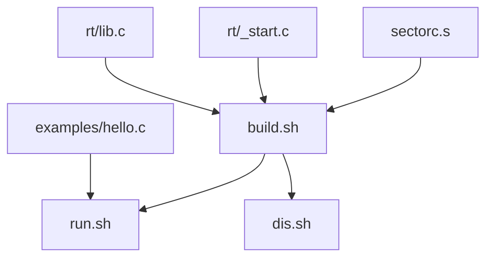

# xorvoid/sectorc

> Compilateur d'un sous-ensemble de C écrit en assembleur x86-16, tenant dans 512 octets.

## Le problème
Aucun besoin pratique : c'est un défi pour voir jusqu'où un compilateur C peut rapetisser.

## Ce que ça fait vraiment
Un compilateur écrit en assembleur 16 bits qui tient dans un secteur de démarrage et accepte une grammaire réduite : variables entières, fonctions void, `if`, `while`, `asm`. Trois exemples : texte à l'écran, sinusoïde en VGA, mélodie au haut-parleur du PC.

## Comment c'est branché


## Essayer
```bash
./build.sh
./run.sh your_source.c
```

## Coût et pièges
Gratuit (CC0). Il faut `nasm` et `qemu-system-i386` ; testé uniquement sur MacBook M1. L'exemple twinkle est bruyant.

## Ce que ce n'est pas
Pas un compilateur C utilisable : l'auteur répond « Probablement rien » à l'utilité. Le sous-ensemble est minuscule.

## Alternatives
sectorforth et sectorlisp, cités dans le README comme prédécesseurs dans un secteur de démarrage.

## Pour toi
À ignorer : curiosité de bas niveau sans usage pour un travail data / IA / MLOps, bonne seulement pour la culture système.

