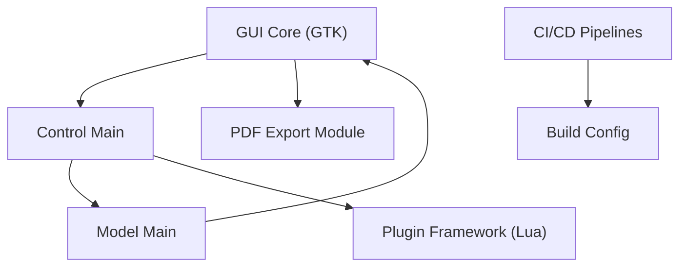

# xournalpp/xournalpp

> Handwritten note-taking and PDF annotation software, for people who write with a stylus.

## The problem
Taking handwritten notes on a graphics tablet or annotating a PDF requires a tool that handles stylus pressure, layers and export.

## What it actually does
A C++ desktop application with a GTK interface: pressure-sensitive styluses, PDF annotation, shapes, text, eraser, LaTeX (requires a LaTeX installation), layers, audio recording and Lua plugins. Exports to SVG, PNG and PDF. `.xopp` files are compressed XML.

## How it is wired


## Trying it
```bash
sudo apt install xournalpp
flatpak install flathub com.github.xournalpp.xournalpp
winget install -e --id Xournal++.Xournal++
```

## Cost and gotchas
Free. On macOS, the app refuses to launch without `xattr -c` followed by `codesign` (see README). The Debian and Ubuntu binaries are tied to a specific version. The mobile app is abandoned.

## What it is not
It is not a knowledge-management tool or a collaborative note editor. The mobile and web app is no longer available.

## Alternatives
No alternative named in the README.

## For you
Keep an eye on it: personal comfort for annotating scientific papers in PDF with a stylus, but unrelated to data / MLOps work.
