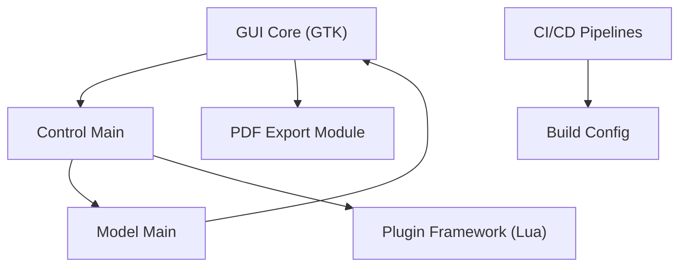

# xournalpp/xournalpp

> Logiciel de prise de notes manuscrites et d'annotation de PDF, pour qui écrit au stylet.

## Le problème
Prendre des notes à la main sur tablette graphique ou annoter un PDF demande un outil qui gère la pression du stylet, les calques et l'export.

## Ce que ça fait vraiment
Application de bureau en C++ avec interface GTK : stylets sensibles à la pression, annotation de PDF, formes, texte, gomme, LaTeX (nécessite une installation LaTeX), calques, enregistrement audio et plugins Lua. Export SVG, PNG et PDF. Les fichiers `.xopp` sont du XML compressé.

## Comment c'est branché


## Essayer
```bash
sudo apt install xournalpp
flatpak install flathub com.github.xournalpp.xournalpp
winget install -e --id Xournal++.Xournal++
```

## Coût et pièges
Gratuit. Sur macOS, l'app refuse de se lancer sans `xattr -c` puis `codesign` (voir README). Les binaires Debian et Ubuntu sont liés à une version précise. L'application mobile est abandonnée.

## Ce que ce n'est pas
Ce n'est pas un outil de gestion de connaissances ni un éditeur de notes collaboratif. L'application mobile et web n'est plus disponible.

## Alternatives
Aucune alternative nommée dans le README.

## Pour toi
À surveiller : confort personnel pour annoter des articles scientifiques en PDF au stylet, mais sans lien avec le travail data / MLOps.

