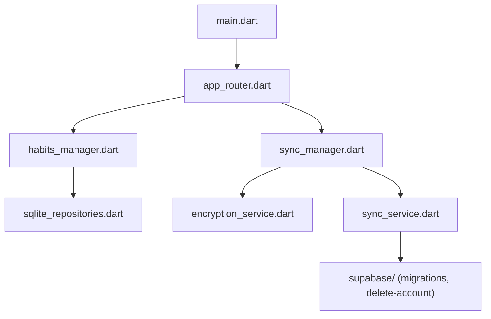

# xpavle00/Habo

> Mobile habit tracker for Android and iOS, offline first, with optional encrypted sync.

## The problem
Classic habit trackers require an account and send your data to a third party. Changing phones loses your history.

## What it actually does
Flutter application: yes/no, numeric or skipped habits, notes, reminders, calendar, statistics, home screen widgets. Data lives in SQLite on the device. Sync and backups are encrypted locally with a master password before being sent to a Supabase backend, which you can host yourself.

## How it is wired


## Trying it
```bash
git clone https://github.com/xpavle00/Habo.git
cd Habo
flutter pub get
flutter run
```

## Cost and gotchas
Free. Flutter 3.x and Android Studio or Xcode to build. Self-hosting the sync requires a Supabase project (free tier sufficient according to the README) and Node for the CLI.

## What it is not
Not a data or AI tool. Offline mode needs no server; multi-device sync is a separate option, not the default.

## Alternatives
No alternative named in the README.

## For you
Watch: unrelated to your data/AI work, but a good example of an offline Flutter architecture with end-to-end encryption and a self-hostable Supabase backend.
