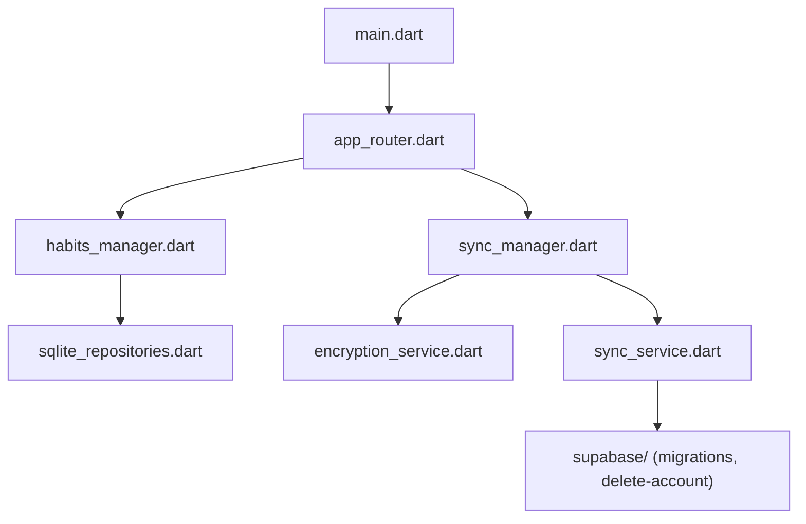

# xpavle00/Habo

> Suivi d'habitudes mobile Android et iOS, hors ligne d'abord, avec synchronisation chiffrée optionnelle.

## Le problème
Les trackers d'habitudes classiques exigent un compte et envoient tes données chez un tiers. Changer de téléphone fait perdre l'historique.

## Ce que ça fait vraiment
Application Flutter : habitudes oui/non, numériques ou ignorées, notes, rappels, calendrier, statistiques, widgets d'écran d'accueil. Les données vivent dans SQLite sur l'appareil. La synchronisation et les sauvegardes sont chiffrées localement avec un mot de passe maître avant envoi vers un backend Supabase, que tu peux héberger toi-même.

## Comment c'est branché


## Essayer
```bash
git clone https://github.com/xpavle00/Habo.git
cd Habo
flutter pub get
flutter run
```

## Coût et pièges
Gratuit. Flutter 3.x et Android Studio ou Xcode pour compiler. L'auto-hébergement de la synchro demande un projet Supabase (niveau gratuit suffisant selon le README) et Node pour la CLI.

## Ce que ce n'est pas
Pas un outil de données ni d'IA. Le mode hors ligne n'a besoin d'aucun serveur ; la synchro multi-appareils est une option distincte, pas le défaut.

## Alternatives
Aucune alternative nommée dans le README.

## Pour toi
Surveiller : sans lien avec ton métier data/IA, mais bon exemple d'architecture Flutter hors ligne avec chiffrement de bout en bout et backend Supabase auto-hébergeable.

