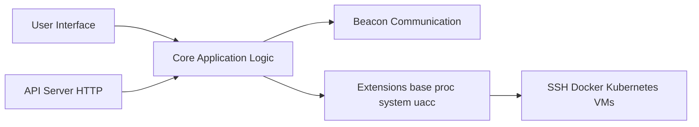

# xpipe-io/xpipe

> Desktop connection hub to servers, containers and VMs, on top of SSH, Docker and the like.

## The problem
Managing hundreds of connections (SSH, containers, Kubernetes, VMs) and their files from a single place.

## What it actually does
Java desktop application: hierarchical connection hub, remote file browser, terminal launcher, reusable scripts, encrypted vault syncable via git. Relies on the programs already installed (ssh, docker, kubectl), installing nothing on the targets. Optional built-in MCP server, HTTP API.

## How it is wired


## Trying it
```bash
bash <(curl -sL https://github.com/xpipe-io/xpipe/raw/master/get-xpipe.sh)
winget install xpipe-io.xpipe --source winget
brew install --cask xpipe-io/tap/xpipe
```

## Cost and gotchas
"Open core" model: homelab/professional features and the shell management library are closed and paid. Desktop application, not to be installed on a server.

## What it is not
Not an orchestration or monitoring tool, not a web interface (except as a webtop container).

## Alternatives
No alternative named in the README.

## For you
Worth watching: comfortable for juggling GPU machines and clusters; check the free scope before adopting it as a team.
