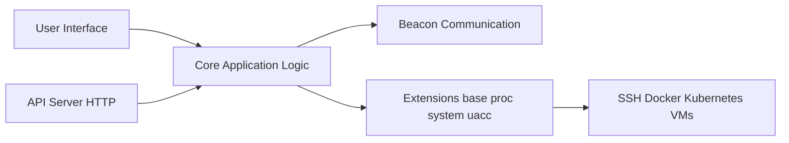

# xpipe-io/xpipe

> Centre de connexions de bureau vers serveurs, conteneurs et VM, par-dessus SSH, Docker et consorts.

## Le problème
Gérer des centaines de connexions (SSH, conteneurs, Kubernetes, VM) et leurs fichiers depuis un seul endroit.

## Ce que ça fait vraiment
Application Java de bureau : hub hiérarchique de connexions, navigateur de fichiers distant, lanceur de terminal, scripts réutilisables, coffre chiffré synchronisable via git. S'appuie sur les programmes installés (ssh, docker, kubectl), sans rien installer sur les cibles. Serveur MCP intégré optionnel, API HTTP.

## Comment c'est branché


## Essayer
```bash
bash <(curl -sL https://github.com/xpipe-io/xpipe/raw/master/get-xpipe.sh)
winget install xpipe-io.xpipe --source winget
brew install --cask xpipe-io/tap/xpipe
```

## Coût et pièges
Modèle « open core » : fonctions homelab/professionnelles et bibliothèque de gestion des shells sont fermées et payantes. Application de bureau, à ne pas installer sur un serveur.

## Ce que ce n'est pas
Pas un outil d'orchestration ni de supervision, pas une interface web (sauf conteneur webtop).

## Alternatives
Aucune alternative nommée dans le README.

## Pour toi
Surveiller : confortable pour jongler entre machines GPU et clusters ; vérifier le périmètre gratuit avant adoption d'équipe.

