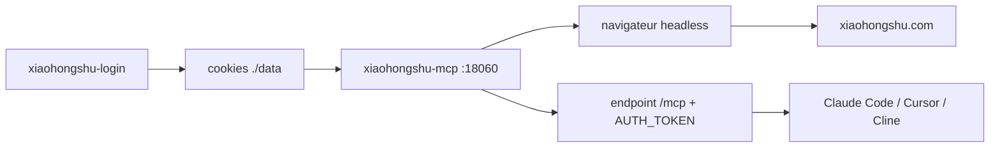

# xpzouying/xiaohongshu-mcp

> MCP server that gives an agent access to a user's Xiaohongshu account.

## The problem
Publishing to and monitoring a Xiaohongshu account from an agent means driving a browser, the session and the `xsec_token` tokens yourself.

## What it actually does
Exposes thirteen MCP tools: `check_login_status`, `get_login_qrcode`,
`delete_cookies`, `publish_content` (title, content, local or HTTP images, tags,
scheduled publishing in ISO8601, originality statement, visibility, products),
`publish_with_video`, `list_feeds`, `search_feeds` with filters for sort order, note type,
date, scope and distance, `get_feed_detail` with comments and interaction data,
`post_comment_to_feed`, `reply_comment_in_feed`, `like_feed`,
`favorite_feed`, `user_profile`. Serves over HTTP on `:18060/mcp`; a separate login tool
records the session.

## How it is wired


## Trying it
```bash
./xiaohongshu-login-darwin-arm64
./xiaohongshu-mcp-darwin-arm64
docker pull xpzouying/xiaohongshu-mcp
claude mcp add --transport http xiaohongshu-mcp http://localhost:18060/mcp
AUTH_TOKEN=your-secret-token ./xiaohongshu-mcp-darwin-arm64
```

## Cost and gotchas
Apache 2.0, free. First launch downloads a headless browser of about 150 MB. Authentication is disabled by default — `AUTH_TOKEN` is recommended in production, and a token passed as a command-line argument is visible in the process list. A single account cannot be logged in on several web sessions: logging in elsewhere kicks the MCP out.

## What it is not
Not an official API: it is browser automation on a platform that did not plan for it. The author reports a year of use without an account ban, but that is a testimonial, not a guarantee; uncertified accounts trigger an identity verification request. macOS Intel and Linux ARM64 are not supported. The README itself warns that going through OpenClaw/MCPorter is not maintained here.

## Alternatives
- xpzouying/x-mcp: browser extension version, no Docker or deployment.
- xiaohongshu-skills: ready-to-use skills variant.

## For you
Without a Xiaohongshu account, there is no use for it. Ignore.
