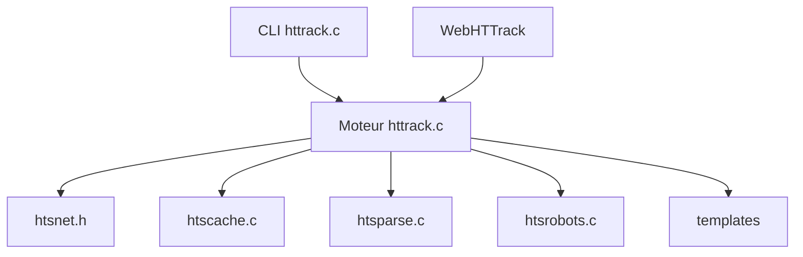

# xroche/httrack

> Website copier that mirrors a site locally so you can browse it offline.

## The problem
Keeping a browsable copy of a site, with its relative links, to read it without a connection or to archive it.

## What it actually does
HTTrack recursively downloads pages, images and files into a local folder, rebuilding the link structure. It updates an existing mirror and resumes interrupted downloads. It is available as a command line tool, as a web interface (WebHTTrack), on Windows (WinHTTrack) and on Android. The engine handles networking, cache, robots, filters and content parsing.

## How it is wired


## Trying it
```bash
git clone https://github.com/xroche/httrack.git --recurse-submodules
cd httrack
./bootstrap
./configure --prefix=$HOME/usr && make -j8 && make install
# ou
./build.sh --prefix=$HOME/usr
# macOS
brew install httrack
```

## Cost and gotchas
Free. From git, you need autoconf, automake and libtool. Copying a site without permission can raise legal questions and put load on the server.

## What it is not
Not a crawler for extracting structured data: it builds a mirror of files.

## Alternatives
No alternative named in the README.

## For you
Keep an eye on it: useful to archive documentation before feeding it to a RAG, but a dedicated crawl engine will be better suited to extraction.
