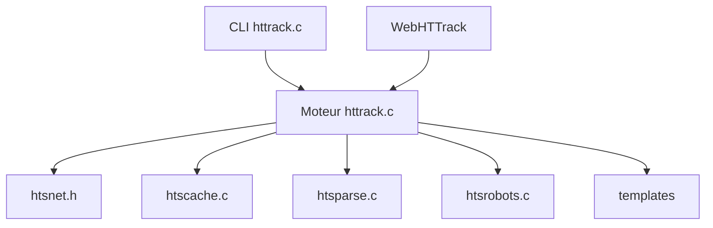

# xroche/httrack

> Aspirateur de sites web qui copie un site en local pour le parcourir hors ligne.

## Le problème
Garder une copie navigable d'un site, avec ses liens relatifs, pour la consulter sans connexion ou l'archiver.

## Ce que ça fait vraiment
HTTrack télécharge récursivement pages, images et fichiers dans un dossier local en refaisant la structure des liens. Il met à jour un miroir existant et reprend les téléchargements interrompus. Il existe en ligne de commande, en interface web (WebHTTrack), sous Windows (WinHTTrack) et sur Android. Le moteur gère réseau, cache, robots, filtres et analyse du contenu.

## Comment c'est branché


## Essayer
```bash
git clone https://github.com/xroche/httrack.git --recurse-submodules
cd httrack
./bootstrap
./configure --prefix=$HOME/usr && make -j8 && make install
# ou
./build.sh --prefix=$HOME/usr
# macOS
brew install httrack
```

## Coût et pièges
Gratuit. Depuis git, il faut autoconf, automake et libtool. Copier un site sans accord peut poser des questions de droit et de charge pour le serveur.

## Ce que ce n'est pas
Pas un crawler pour extraire des données structurées : il fabrique un miroir de fichiers.

## Alternatives
Aucune alternative nommée dans le README.

## Pour toi
Surveiller : utile pour archiver une documentation avant de la donner à un RAG, mais un moteur de crawl dédié sera plus adapté à l'extraction.

