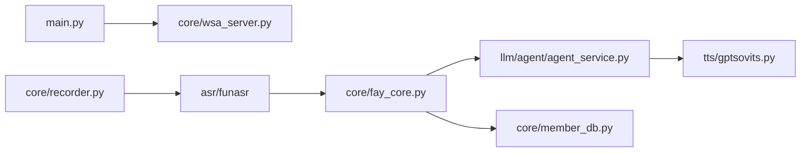

# xszyou/Fay

> Chinese digital-human framework linking ASR, LLM, TTS and avatars for a variety of terminals.

## The problem
Plugging a talking avatar into an LLM and interchangeable speech recognition and synthesis, for an app, the web or a microcontroller.

## What it actually does
Python server with text, voice, avatar control, automatic broadcast and intent interfaces.
OpenAI-compatible LLMs, ASR (FunASR, Ali…) and TTS (GPT-SoVITS, Azure, Volcano…) are interchangeable.
Agent with tool calls, MCP handling, custom knowledge base and QA (`qa.csv`), multi-user.
Admin page at `127.0.0.1:5000`.

## How it is wired


## Trying it
```bash
pip install -r requirements.txt
python main.py start -config_center d19f7b0a-2b8a-4503-8c0d-1a587b90eb69
```

## Cost and gotchas
Free; the public config key is slow, you need your own. Python 3.12, portaudio on Ubuntu.

## What it is not
Not documented in English: the docs are on Feishu, in Chinese. The README's "commercial without liability" contrasts with the GPL.

## Alternatives
No named alternative; openclaw, OpenAI Codex and FunASR are cited as references.

## For you
Ignore outside a voice-avatar project in a Chinese context: docs and ecosystem are hard to access.
